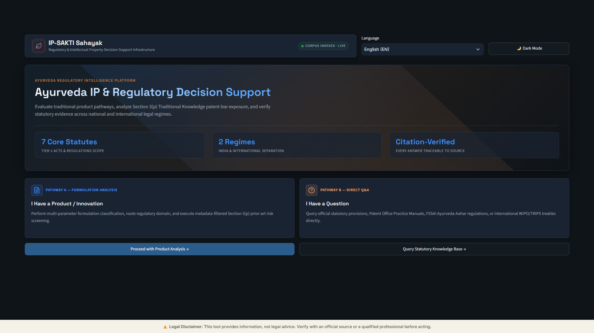
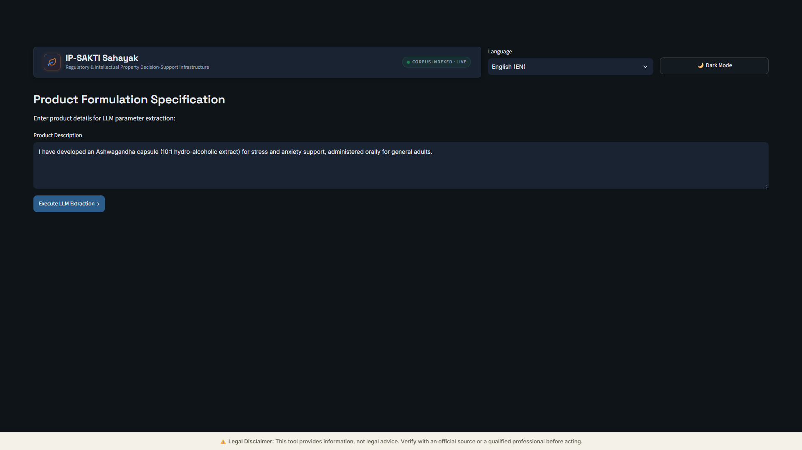
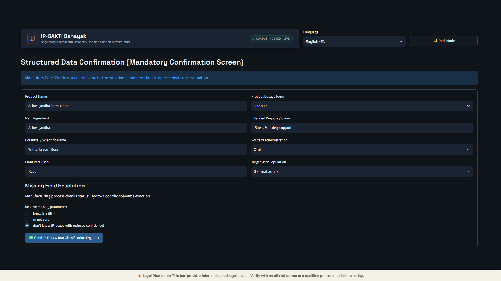
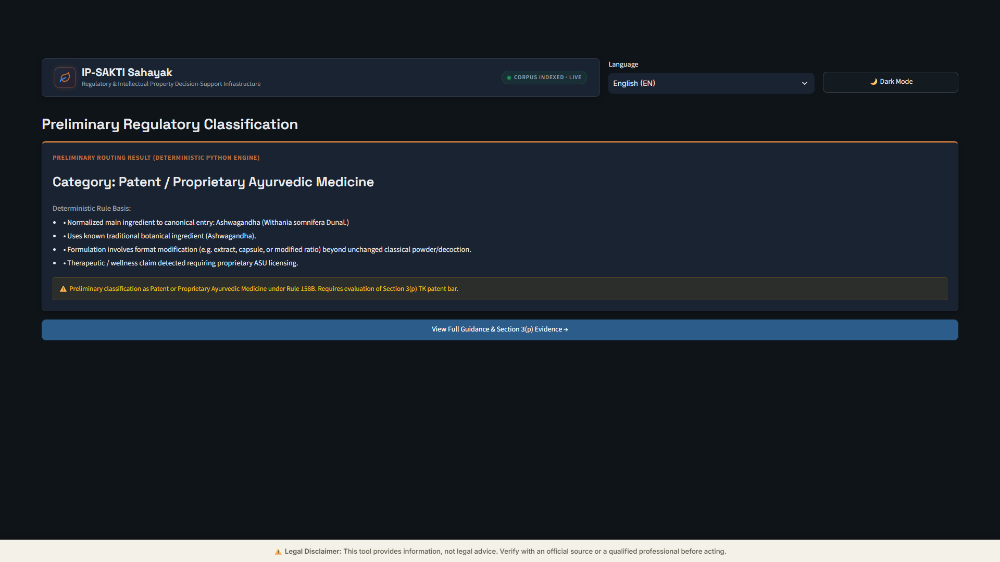
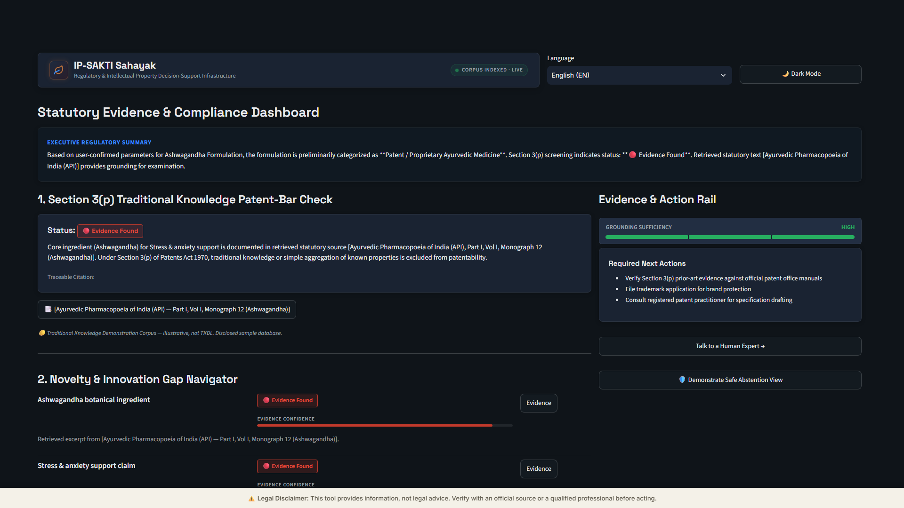
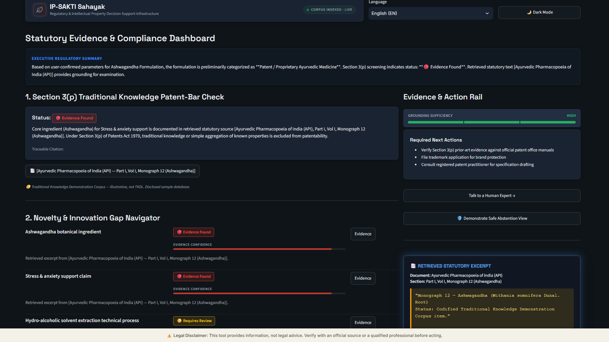

# IP-SAKTI Sahayak (🏛️ आयुर्वेद नियामक सहाय्यक)

> **Regulatory & Intellectual Property Decision-Support Infrastructure for Ayurveda Innovations**

IP-SAKTI Sahayak is a specialized, multi-stage legal and regulatory intelligence platform designed for Ayurvedic formulations, herbal extracts, and traditional medicine innovations. It evaluates statutory product pathways under Indian law (Drugs & Cosmetics Act, FSSAI Ayurveda-Aahar, Biological Diversity Act) and international treaties (WIPO GRATK Treaty, Nagoya Protocol), screens patent-eligibility risks under **Section 3(p) of the Patents Act, 1970**, and navigates novelty gaps with citation-grounded evidence.

---

## Table of Contents

- [Overview](#overview)
- [Key Capabilities](#key-capabilities)
- [Application Screenshots](#application-screenshots)
  - [1. Main Application Interface](#1-main-application-interface)
  - [2. Product Formulation Input](#2-product-formulation-input)
  - [3. Human Confirmation Step](#3-human-confirmation-step)
  - [4. Regulatory Classification](#4-regulatory-classification)
  - [5. Traditional Knowledge Screening](#5-traditional-knowledge-screening)
  - [6. Evidence and IPR Recommendations](#6-evidence-and-ipr-recommendations)
- [Feature Status: Demonstrated vs. Planned](#feature-status-demonstrated-vs-planned)
- [System Architecture & Processing Pipeline](#system-architecture--processing-pipeline)
- [Statutory Corpus Scope](#statutory-corpus-scope)
- [Local Installation & Setup](#local-installation--setup)
- [Running the Test Suites](#running-the-test-suites)
- [Legal & Regulatory Disclaimer](#legal--regulatory-disclaimer)

---

## Overview

Traditional Ayurvedic formulations encounter unique statutory friction when entering modern commercial and intellectual property ecosystems. In India, **Section 3(p) of the Patents Act, 1970** bars patenting of traditional knowledge or aggregations/duplications of known herbal properties. Simultaneously, classification determines whether a product is regulated as a **Classical ASU Medicine**, **Patent/Proprietary ASU Medicine (Rule 158B)**, **Ayurveda-Aahar (FSSAI 2022)**, **Phytopharmaceutical Drug**, or **Cosmetic**.

IP-SAKTI Sahayak bridges this gap through:
1. **Deterministic Regulatory Routing**: Pure rule-based Python logic (zero hallucination risk for statutory branching).
2. **Universal-7 Parameter Extraction**: Structured parameterization of product formulation details.
3. **Mandatory Human Confirmation Gate**: Enforces user review of extracted parameters prior to legal rule evaluation.
4. **Metadata-Filtered Vector Retrieval**: Scoped semantic and exact retrieval against indexed Tier-1 statutory corpora in local Chroma DB.
5. **Traceable Statutory Grounding**: Every finding cites document, section, and verified verbatim statutory excerpt.
6. **Safe Abstention Protocol**: Explicit refusal to generate speculative guidance when inputs contain unrecognized substances or insufficient grounding.

---

## Key Capabilities

- **Dual Interaction Pathways**:
  - **Pathway A (Formulation Analysis)**: End-to-end multi-parameter regulatory classification, Section 3(p) prior-art risk analysis, and innovation-gap navigation.
  - **Pathway B (Direct Statutory Q&A)**: Direct semantic queries against indexed Indian Acts, Patent Office Manuals, and international treaties.
- **Strict Jurisdiction Isolation**: Dedicated filtering for India, International (WIPO GRATK 2024 / TRIPS / Nagoya), or comparative analysis without cross-jurisdiction contamination.
- **Evidence Confidence & Sufficiency Gauges**: 3-tier visual sufficiency meter (`HIGH` / `MEDIUM` / `LOW`) and color-coded status badges (`🔴 Evidence Found`, `🟡 Requires Review`, `🔵 No Direct Match in Searched Corpus`).
- **Interactive Citation Rail**: Asymmetric layout with slide-out glassmorphism drawer showing verified primary statutory text.

---

## Application Screenshots

The screenshots below highlight the core end-to-end workflow and primary decision-support capabilities of IP-SAKTI Sahayak, captured from the live application at 1920×1080 resolution using a synthetic sample formulation (*Ashwagandha Stress Relief Formulation*).

### 1. Main Application Interface
The central portal dashboard featuring dual-pathway routing (Formulation Analysis vs. Direct Statutory Q&A), active indexed corpus status indicator, multi-lingual language selector, and statutory coverage metrics.


*Figure 1: Welcome interface with pathway selection, live corpus status, and statutory scope strip.*

---

### 2. Product Formulation Input
Structured input interface capturing botanical composition, extraction ratio, dosage form, intended therapeutic claims, and administration route.


*Figure 2: Product formulation specification screen capturing active ingredients and claims.*

---

### 3. Human Confirmation Step
Mandatory human-in-the-loop confirmation gate displaying AI-extracted Universal-7 formulation parameters for user verification before rule evaluation.


*Figure 3: Parameter verification gate ensuring formulation accuracy before classification.*

---

### 4. Regulatory Classification
Preliminary statutory classification generated by the deterministic Python rule engine, showing category assignment, rule basis bullets, and statutory disclaimers.


*Figure 4: Deterministic regulatory routing result with statutory rule rationale.*

---

### 5. Traditional Knowledge Screening
Section 3(p) Traditional Knowledge patent-eligibility screening dashboard with status badge, evidence summary, and grounding sufficiency meter.


*Figure 5: Section 3(p) prior-art screening dashboard with grounding sufficiency evaluation.*

---

### 6. Evidence and IPR Recommendations
Core intellectual property protection strategy mapping (Patents, Trademarks, Trade Secrets) alongside the slide-out glassmorphism drawer displaying verified primary statutory excerpts.


*Figure 6: IPR recommendation map with active glassmorphism citation rail showing verbatim statutory authority.*

---

**[View all 13 application screenshots →](https://github.com/0504Siddhi/IP_SAKTI_SIH/tree/main/docs/screenshots)**

---

## Feature Status: Demonstrated vs. Planned

To maintain transparency, the table below outlines the operational status of all system components:

| Feature / Module | Status | Implementation Details |
| :--- | :---: | :--- |
| **Welcome & Dual Pathway Routing** | **Demonstrated (Live)** | Fully functional interactive UI router in `app.py`. |
| **Jurisdiction Scoping** | **Demonstrated (Live)** | Strict metadata-filtered retrieval for India vs. International. |
| **Free-Text Intake & Parameterization** | **Demonstrated (Live)** | Universal-7 parameter extraction with offline heuristic fallback. |
| **Mandatory Confirmation Gate** | **Demonstrated (Live)** | Interactive form gate; requires confirmation before rule execution. |
| **7-Category Deterministic Classifier** | **Demonstrated (Live)** | 100% deterministic pure-Python decision tree in `classifier.py`. |
| **Section 3(p) Risk Screening** | **Demonstrated (Live)** | Chroma DB vector search against Patents Act & API monographs. |
| **Innovation Gap Navigator** | **Demonstrated (Live)** | Granular feature decomposition with confidence progress bars. |
| **Interactive Citation Rail** | **Demonstrated (Live)** | Glassmorphism drawer rendering verbatim Level-A statutory text. |
| **Direct Statutory Q&A** | **Demonstrated (Live)** | Semantic search across indexed legal corpus with instant retrieval. |
| **Safe Abstention Protocol** | **Demonstrated (Live)** | Guardrail in `synthesizer.py` rejecting fake/ungrounded inputs. |
| **Expert Legal Escalation** | **Demonstrated (Live)** | Official authority portal directory and escalation workflows. |
| **Dark / Light Theme Toggle** | **Demonstrated (Live)** | Dynamic CSS variable injection in `styles.css`. |
| **Multi-Language Selector** | **Demonstrated (Live UI)** | Language dropdown implemented; localized legal texts in roadmap. |
| **Vision-OCR Label Scanning** | *Simulated / Prototype* | OCR input simulated via offline normalized text extractor. |
| **Official TKDL Integration** | *Planned / Disclaimed* | Uses illustrative demonstration corpus; official TKDL requires government credentials. |
| **Automated Patent Draft Generator** | *Planned Roadmap* | Specification drafting requires certified patent practitioner. |

---

## System Architecture & Processing Pipeline

```
                                      +-----------------------------------+
                                      |   User Input: Product Narrative   |
                                      +-----------------------------------+
                                                        |
                                                        v
                                      +-----------------------------------+
                                      |  Step 3: Universal-7 Extraction   |
                                      |   (Heuristic / Gemini Fallback)   |
                                      +-----------------------------------+
                                                        |
                                                        v
                                      +-----------------------------------+
                                      |  Step 3: Mandatory Confirmation   |
                                      |       Form Gate (Human Review)    |
                                      +-----------------------------------+
                                                        |
                                                        v
                               +------------------------+------------------------+
                               |                                                 |
                               v                                                 v
           +---------------------------------------+         +---------------------------------------+
           |   Step 2: Deterministic Classifier    |         |   Step 4: Metadata-Filtered Retrieval |
           |  (7 Statutory Categories in Python)   |         |      (Chroma DB Vector Collection)    |
           +---------------------------------------+         +---------------------------------------+
                               |                                                 |
                               +------------------------+------------------------+
                                                        |
                                                        v
                                      +-----------------------------------+
                                      |   Step 6: Sufficiency Check &     |
                                      |     Safe Abstention Threshold     |
                                      +-----------------------------------+
                                           /                         \
                          [Sufficiency < LOW]                       [Sufficiency OK]
                                         /                             \
                                        v                               v
                       +-------------------------------+  +-------------------------------+
                       |    Safe Abstention Screen     |  |   Step 5: Grounded Synthesis  |
                       | ("We Can't Reliably Answer")  |  |   & Evidence Citation Rail    |
                       +-------------------------------+  +-------------------------------+
```

---

## Statutory Corpus Scope

The local Chroma database (`./chroma_db`) indexes 34 chunked, metadata-tagged documents across primary regulatory and IP authorities:

1. **The Patents Act, 1970 (Amended 2024)**: Section 3(p), Section 3(e), Rule 13(d), Form 1 declarations.
2. **Manual of Patent Office Practice and Procedure**: Chapter 08.03.02 (Traditional Knowledge & Biological Inventions).
3. **Drugs and Cosmetics Act, 1940 & Rules 1945**: Section 3(a), Rule 158B (Patent/Proprietary ASU licensing criteria).
4. **FSSAI Ayurveda-Aahar Regulations, 2022**: Regulation 3, Schedule I-IV (Permitted food ingredients & limits).
5. **Biological Diversity Act, 2002 (Amended 2023)**: Section 3, Section 6 (Mandatory NBA Access & Benefit Sharing).
6. **WIPO GRATK Treaty (2024)**: Article 3 (Mandatory disclosure of genetic resources and associated TK origin).
7. **Ayurvedic Pharmacopoeia of India (API Part I & II)**: Official botanical monographs (Withania somnifera, Curcuma longa).

---

## Local Installation & Setup

### Prerequisites
- Python 3.10, 3.11, or 3.12
- Local persistent storage (for Chroma DB vector embeddings)
- Google Chrome or modern web browser

### 1. Clone Repository & Install Dependencies
```bash
git clone https://github.com/your-org/ip_sakti_sahayak.git
cd ip_sakti_sahayak
pip install -r requirements.txt
```

### 2. Ingest Statutory Corpus into Chroma DB
```bash
python ingest.py
```
*Expected output: `[OK] Step 1 Corpus Ingestion Complete! Total indexed records in Chroma: 34`*

### 3. Launch Streamlit Application
```bash
streamlit run app.py
```
Open your browser at `http://localhost:8501`.

---

## Running the Test Suites

The repository includes comprehensive automated test suites covering classification, retrieval, extraction, and golden end-to-end test cases:

```bash
# Run all unit tests
python -m unittest discover

# Run the 6 Golden Test Cases
python golden_tests.py
```

### Verified Test Cases:
1. `test_ashwagandha_stress_capsule`: Proprietary ASU formulation with 10:1 extract (`Patent / Proprietary Ayurvedic Medicine`).
2. `test_chyawanprash_classical`: Classical unchanged Avaleha formulation (`Classical / Generic ASU Medicine`).
3. `test_turmeric_phytopharmaceutical`: Purified curcuminoid nano-emulsion (`Phytopharmaceutical Pathway`).
4. `test_synthetic_drug_injection`: Paracetamol synthetic API injection (`New / Non-Classical Drug`).
5. `test_vibranium_bhasma_abstention`: Fake ingredient triggering `Safe Abstention Protocol`.
6. `test_international_jurisdiction_gratk`: Cross-border PCT filing triggering WIPO GRATK mandatory disclosure.

---

## Legal & Regulatory Disclaimer

> ⚠️ **IMPORTANT NOTICE:**  
> IP-SAKTI Sahayak is an informational decision-support and educational tool. **It does NOT provide legal advice, binding patentability opinions, or official regulatory approvals.**
> 
> The Traditional Knowledge demonstration database contained in this software is an illustrative sample and is **NOT** the official government Traditional Knowledge Digital Library (TKDL). Prior to commercial manufacture, patent filing, or marketing of any ASU formulation, innovators must consult:
> - A registered Patent Agent or IP attorney registered with the CGPDTM.
> - The State Licensing Authority (Ayush) under the Drugs and Cosmetics Act.
> - The National Biodiversity Authority (NBA) for biological resource clearance.
